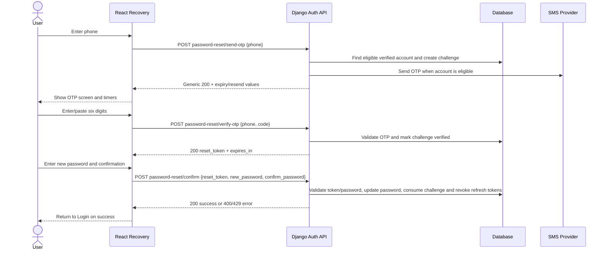

# Habitree authentication module

**Status:** current frontend implementation, reviewed against the supplied Django API2 source on 2026-11-11.

This document describes the code currently in this repository. The backend remains authoritative for validation, OTP validity, throttling, password policy, token validity and account creation.

## 1. Routes and user journeys

| Journey | Route | Responsibility |
| --- | --- | --- |
| Login | `/login` | Phone number + password |
| Registration | `/register` | Collect phone and request OTP |
| Registration OTP | `/register/verify-code` | Collect six digits; auto-submit to Django |
| Registration details | `/register/details` | Name, username, password, confirmation and terms |
| Recovery | `/forgot-password` | Request password-reset OTP |
| Recovery OTP | `/verify-reset-code` | Collect six digits; auto-submit to Django |
| New password | `/reset-password` | Set and confirm a new password |

Registration and recovery state is held in their React providers in memory. Refreshing the page or opening a later-stage URL directly restarts the relevant journey at its first step. This is frontend flow control; it does not replace backend verification.

## 2. Registration — API2

1. `RegisterPhonePage` validates the phone format for usability and calls `POST /api/auth/register/send-otp/` with `{ "phone": "..." }`.
2. Django returns `expires_in` and `resend_after` in seconds. `RegisterOtpPage` uses those server values to show the validity timer and resend cooldown. Resend is disabled until the backend-provided cooldown ends.
3. When six digits are entered or pasted, the shared `OtpInput` submits automatically to `POST /api/auth/register/verify-otp/` with `{ "phone": "...", "code": "123456" }`. The manual submit button remains as an accessibility/fallback path.
4. Only a successful server response `{ "registration_token": "...", "expires_in": ... }` moves the flow to `/register/details`. An invalid code remains on the OTP page. The client also blocks submission after the local server-derived expiry deadline; Django independently enforces expiry and attempt limits.
5. `RegisterDetailsPage` sends `registration_token`, `username`, `full_name`, `password`, `confirm_password`, `timezone`, `locale` and `terms_accepted` to `POST /api/auth/register/complete/`.
6. HTTP 201 returns the user and an access token; Django sets the refresh cookie. The frontend deliberately does not persist the JSON access token from registration and routes to `/login`.

### Registration API contract

| Request | Body | Success response | Main errors handled by frontend |
| --- | --- | --- | --- |
| `POST /api/auth/register/send-otp/` | `{ phone }` | `200`: `detail`, `expires_in`, `resend_after` | `400`, `409`, `429`, `502` |
| `POST /api/auth/register/verify-otp/` | `{ phone, code }` | `200`: `detail`, `registration_token`, `expires_in` | `400`, `409`, `429` |
| `POST /api/auth/register/complete/` | `{ registration_token, username, full_name, password, confirm_password, timezone, locale, terms_accepted }` | `201`: `detail`, `user`, `access` + refresh cookie | `400`, `409`, `429`, `500` |

Django's OTP is verified before account creation. The final details request does not send the raw OTP or phone number; the short-lived registration token binds the verified phone/challenge to completion.

## 3. Login

`LoginForm` sends `POST /api/auth/login/` with `{ "phone": "...", "password": "..." }`.

On HTTP 200, the service validates the returned user/access fields, keeps the short-lived access token in module memory and shows a success status. The backend sets the refresh token as an HttpOnly cookie. No password or token is written to LocalStorage, SessionStorage, a URL or application logs.

The current login API does **not** accept `remember_me`. The checkbox is intentionally disabled and labelled as coming soon. Do not enable it in the frontend until the backend defines and implements the session-duration behavior.

### Login/session limitation

The supplied backend config sets a 15-minute access-token lifetime and a seven-day refresh-token lifetime. The refresh cookie is named `habitree_refresh`, has `HttpOnly=True`, defaults to `SameSite=Lax` and `Path=/api/auth/`, and is configured `Secure=True` outside DEBUG unless explicitly overridden. However, the current `token/refresh/` and `token/blacklist/` routes are the stock SimpleJWT views; they expect a refresh token in the JSON body and do not read the HttpOnly cookie. The frontend has no cookie-aware session bootstrap/refresh or logout flow yet.

Consequently, after a full page reload the in-memory access token is gone and the frontend cannot currently restore the authenticated session from the HttpOnly cookie. The current router also has no authenticated-user provider/protected-route gate, and Login displays a success status rather than entering a protected dashboard. Do not describe persistent login, Remember Me or the complete session lifecycle as finished until backend and frontend refresh/logout/user-state work is added.

## 4. Password recovery

1. `ForgotPasswordPage` calls `POST /api/auth/password-reset/send-otp/` with `{ "phone": "..." }`.
2. The backend returns a generic `200` response with `expires_in` and `resend_after`. This is intentional to avoid revealing whether a phone number belongs to an account. A 200 response does not prove that an SMS was delivered.
3. The OTP screen shows the server-derived expiry and resend countdowns. Six digits trigger automatic verification; the manual button remains available. Expired codes are disabled in the UI and rejected independently by Django.
4. `POST /api/auth/password-reset/verify-otp/` receives `{ "phone": "...", "code": "123456" }`. On success, Django returns a short-lived `reset_token` and `expires_in`. The reset token stays in React memory only.
5. `ResetPasswordPage` sends `{ "reset_token": "...", "new_password": "...", "confirm_password": "..." }` to `POST /api/auth/password-reset/confirm/`. On success, Django changes the password, consumes the reset challenge and blacklists outstanding refresh tokens. The user returns to Login.

### Recovery API contract

| Request | Body | Success response | Main errors handled by frontend |
| --- | --- | --- | --- |
| `POST /api/auth/password-reset/send-otp/` | `{ phone }` | `200`: `detail`, `expires_in`, `resend_after` | `400`, `429` |
| `POST /api/auth/password-reset/verify-otp/` | `{ phone, code }` | `200`: `detail`, `reset_token`, `expires_in` | `400`, `429` |
| `POST /api/auth/password-reset/confirm/` | `{ reset_token, new_password, confirm_password }` | `200`: `detail` | `400`, `429` |

## 5. Shared components and project structure

Feature ownership is separated by journey:

```text
src/features/authentication/
├── login/
│   ├── LoginPage.tsx
│   ├── components/
│   ├── hooks/
│   └── services/
├── register/
│   ├── RegisterPhonePage.tsx
│   ├── RegisterOtpPage.tsx
│   ├── RegisterDetailsPage.tsx
│   ├── components/
│   ├── hooks/
│   ├── services/
│   └── utils/
├── recovery/
│   ├── ForgotPasswordPage.tsx
│   ├── VerifyOtpPage.tsx
│   ├── ResetPasswordPage.tsx
│   ├── components/
│   ├── hooks/
│   └── services/
└── shared/
    ├── components/
    ├── hooks/
    └── utils/
```

- `src/shared` owns app-wide infrastructure/primitives: Axios client, generic `Button`/`Input`, and phone numeral normalization.
- `authentication/shared` owns controls shared only by auth journeys: `AuthLayout`, `AuthHeader`, `BotanicalWelcome`, `PhoneNumberInput`, `PasswordInput`, `PasswordRequirements`, `OtpInput`, `OtpResendControls` and `useOtpCountdown`.
- One `OtpInput` is shared by registration and recovery. The journeys retain independent providers, state and API services.
- One `useOtpCountdown` and one `OtpResendControls` serve both OTP journeys. The hook uses absolute server-derived deadlines, so background-tab timer throttling does not extend the OTP validity.
- `PasswordInput` is reused by Login, registration and recovery. New-password guidance is shared by registration and recovery.
- Services map UI-level types to backend wire schemas; React pages do not construct raw API requests.

## 6. Security boundaries

- Passwords and OTP digits remain in form/component memory only.
- Registration proof and password-reset token remain in provider memory only; they are not persisted or placed in navigation state/URLs.
- Access JWT from Login is held in module memory only.
- Refresh JWT is set by Django in an HttpOnly cookie; JavaScript cannot create or read an HttpOnly cookie.
- Django validates OTP expiry, one-time use, attempt limits, phone/username uniqueness, terms acceptance and password rules. Frontend validation is for usability and never replaces server validation.
- The frontend password checklist currently asks for at least eight characters, one English letter and one digit. Django additionally applies user-attribute similarity, minimum-length, common-password and numeric-password validators. Django remains authoritative; if these policies are intentionally to be identical, the team must agree the exact shared rules and update both sides.
- The recovery send endpoint intentionally gives a generic response for eligible and ineligible phone numbers.
- Never put API secrets, SMS provider credentials, Django `SECRET_KEY`, or other server secrets in `VITE_` variables. Vite variables are visible in the browser bundle.

## 7. Responsive behavior

The authentication shell uses a two-column botanical/form layout at widths of 1024px and above. Below 1024px the botanical panel is hidden and the form becomes a centered, full-width column. Mobile spacing changes below 640px. The root document supports a minimum width of 320px. Very short desktop windows can scroll vertically instead of clipping controls.

Responsive E2E checks cover 320px, 390px, 768px, 1024px and 1440px widths for Login, Registration and Recovery. Login also has a landscape viewport check. These checks must be run in a real browser; CSS inspection alone is not proof of responsive behavior.

## 8. Environment and local run

Copy `.env.example` to `.env.local` in the Frontend root (beside `package.json`):

```env
VITE_API_BASE_URL=/api
VITE_API_PROXY_TARGET=http://127.0.0.1:8000
VITE_ENABLE_AUTH_REGISTRATION_MOCK=false
VITE_ENABLE_AUTH_RECOVERY_MOCK=false
```

- `VITE_API_BASE_URL` defaults to `/api`.
- `VITE_API_PROXY_TARGET` is the host-reachable Django address used by Vite in local development. If Docker publishes Django on a different host port, change this value.
- Both mock flags must remain `false` when testing the real backend. `true` is only for explicit local UI simulation; mocks are guarded by `import.meta.env.DEV`.
- Restart Vite after changing environment variables.
- In production, Nginx should route `/api` to Django and `/` to the frontend; use HTTPS and configure the backend's allowed CORS/CSRF origins for the actual deployment.

Commands:

```bash
npm ci
npm run dev
npm run build
npm run lint
npm run test:e2e
```

Backend Swagger UI is available at `/api/docs/` when Django is running. Its OpenAPI schema is at `/api/schema/`.

## 9. Test coverage and known gaps

Playwright E2E tests cover:
- Login required-field validation, phone normalization, successful API response, invalid credentials, rate limiting, password visibility, accessibility semantics and responsive layout.
- Registration send/verify/complete payloads, invalid phone, duplicate phone, wrong OTP/retry, expired registration token, stage-route guards, explicit mock isolation, server-derived OTP expiry/resend and responsive layout.
- Recovery send/verify/confirm payloads, wrong OTP/retry, resend, expired OTP, rate-limit mapping, route guards and responsive layout.
- External HTTP calls are intercepted with Playwright `page.route` in browser tests; the UI mock mode is explicit and does not send network requests.

The CI workflow runs `npm ci`, ESLint, the production build and Playwright. It uploads the HTML report and failure artifacts.

The full metric-by-metric review is in [`authentication-rubric-checklist.md`](./authentication-rubric-checklist.md); the missing backend cases are specified in [`authentication-backend-test-plan.md`](./authentication-backend-test-plan.md).

**Not yet complete for the whole project rubric:** the supplied backend archive has an empty `accounts/tests.py` (only the default test skeleton), so backend unit/API integration coverage and coverage percentage are not demonstrated. The supplied repository also does not contain a Figma prototype link or complete C4 Context/Container/Component diagram set. The auth sequence diagrams below document the journeys, but they do not replace project-wide C4 diagrams. Cookie-aware refresh/session bootstrap and logout also remain pending as described above.

## 10. Authentication sequence diagrams

### Login

```mermaid
sequenceDiagram
    actor User
    participant React as React Login
    participant API as Django Login API
    participant DB as Database
    User->>React: Enter phone and password
    React->>React: Validate form fields
    React->>API: POST /api/auth/login/
    API->>DB: Authenticate user and check active/verified phone
    alt Valid credentials
        DB-->>API: User
        API-->>React: 200 user + access; Set-Cookie HttpOnly refresh
        React->>React: Keep access token in memory
        React-->>User: Show login success
    else Invalid credentials / rate limit
        API-->>React: 400/401 or 429
        React-->>User: Show mapped error
    end
```

### Registration

```mermaid
sequenceDiagram
    actor User
    participant React as React Registration
    participant API as Django Auth API
    participant DB as Database
    participant SMS as SMS Provider
    User->>React: Enter phone
    React->>API: POST register/send-otp {phone}
    API->>DB: Create OTP challenge with expiry
    API->>SMS: Send OTP
    API-->>React: 200 expires_in + resend_after
    React->>User: Show expiry and resend timers
    User->>React: Enter/paste six digits
    React->>API: POST register/verify-otp {phone, code}
    API->>DB: Validate OTP, expiry and attempt count
    alt OTP valid
        API-->>React: 200 registration_token + expires_in
        User->>React: Enter profile and password
        React->>API: POST register/complete with registration_token and profile
        API->>DB: Validate token/password/terms; create user and consume challenge
        API-->>React: 201 user + access; Set-Cookie HttpOnly refresh
        React-->>User: Navigate to Login
    else OTP invalid/expired or throttled
        API-->>React: 400/409/429
        React-->>User: Stay on OTP page and show error
    end
```

### Password recovery


